[← Back to Project Overview](../README.md) | [Day 2: Domain Users →](../day-02-domain-users/README.md)

# Day 1: Windows Server 2022 Domain Controller & AD CS Setup

Today I set up my first Windows Server 2022 Domain Controller from scratch in VirtualBox:

- Renamed the server
- Installed Active Directory Domain Services (AD DS)
- Promoted it to a Domain Controller, and
- Created my first forest and domain

I also configured Active Directory Certificate Services (AD CS) with an Enterprise Root CA.

## What I Completed

1. Renamed the server to `DC01`
2. Installed the AD DS role
3. Configured a new forest (`LAB.local`)
4. Prerequisites check — all passed
5. Logged in as domain admin — promotion confirmed
6. Installed AD CS role
7. Configured AD CS successfully

> **Next up:** Joining a client machine to the domain.

---

## Screenshots & Walkthrough

### 1. Rename the Server to `DC01`
Renamed the fresh Windows Server 2022 VM (`WIN-1TTSL21IOLL`) to `DC01` before promoting it.

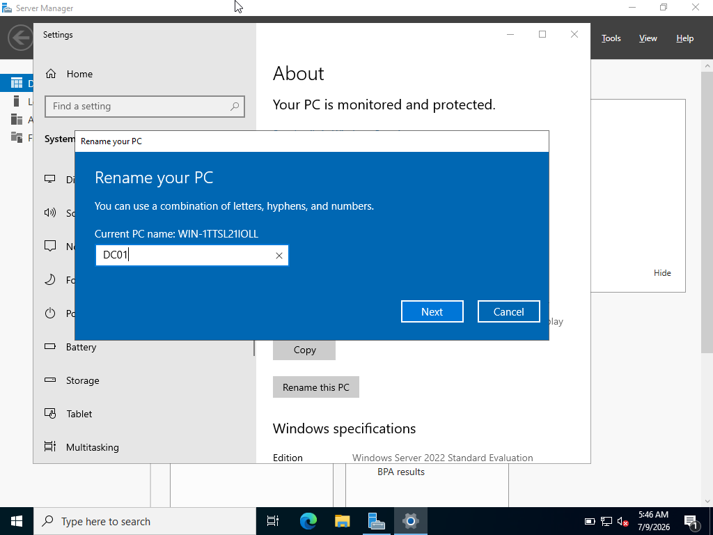

### 2. Launch Add Roles and Features Wizard
Opened Server Manager on `DC01` and started the Add Roles and Features Wizard.

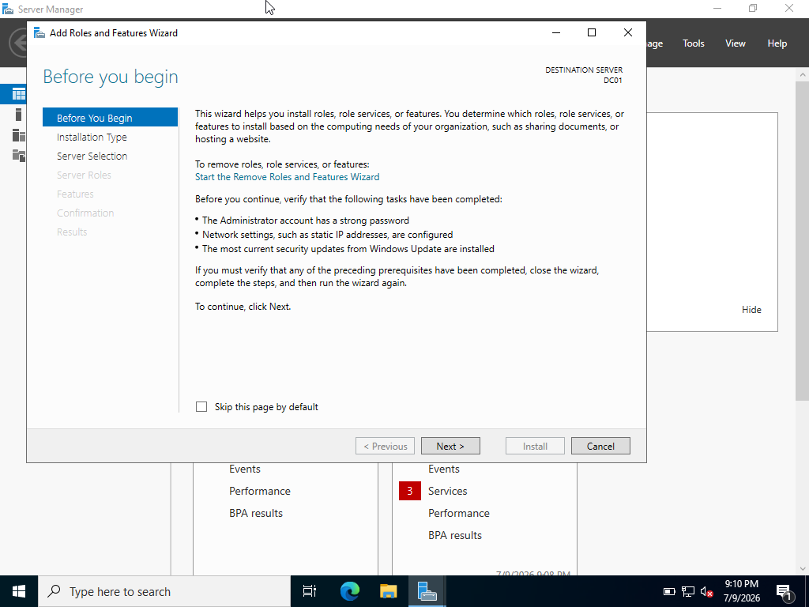

### 3. Select the AD DS Server Role
Selected **Active Directory Domain Services** from the Server Roles list.

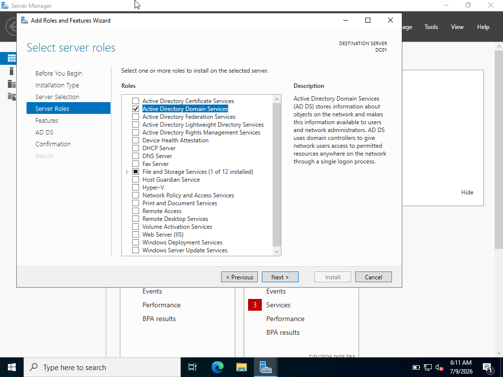

### 4. Install AD DS and Management Tools
Installed AD DS along with Group Policy Management and RSAT AD DS Tools (including AD PowerShell module and AD Administrative Center).

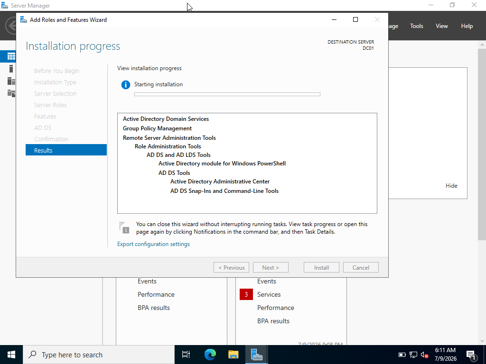

### 5. Configure a New Forest (`LAB.local`)
Promoted `DC01` by choosing **Add a new forest** with root domain name `LAB.local`.

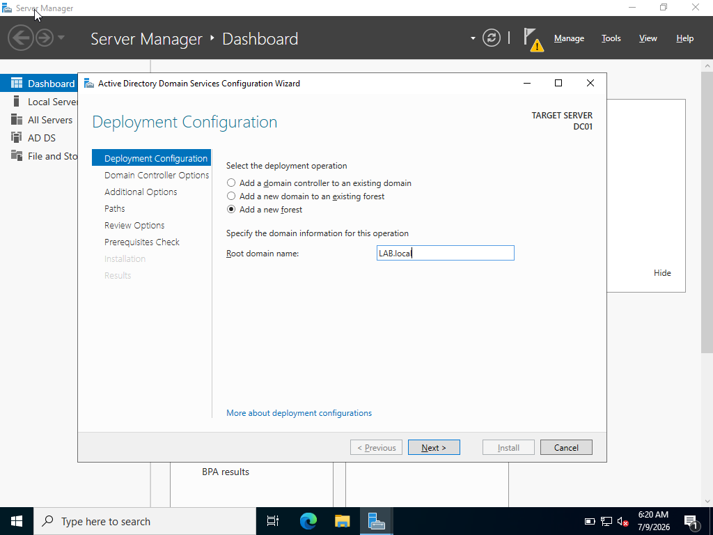

### 6. Confirm Domain Controller Promotion
Prerequisites check passed and the configuration wizard confirmed `DC01` was successfully configured as a domain controller.

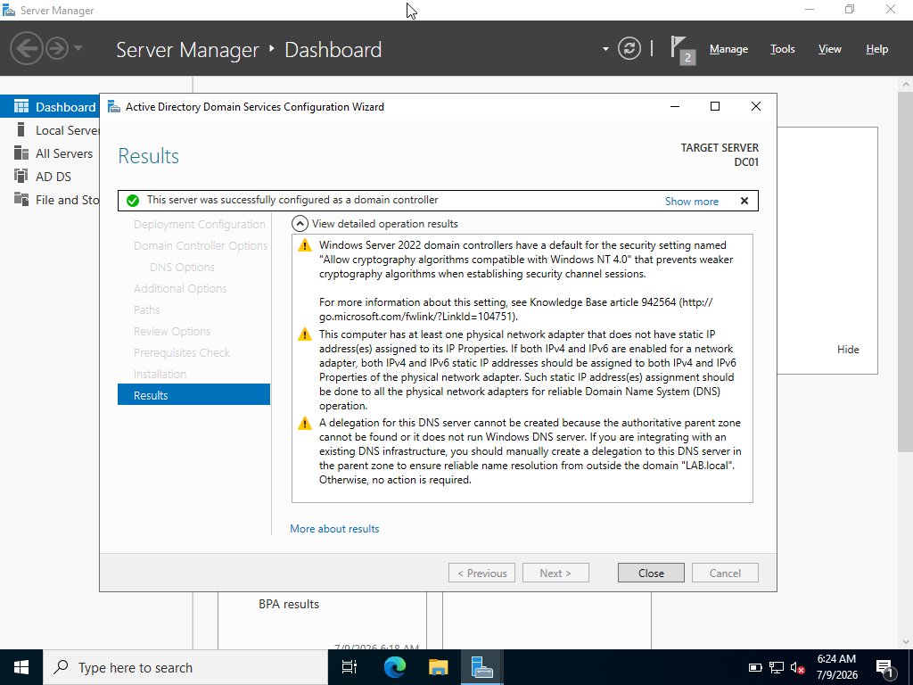

### 7. Sign In as Domain Administrator
Rebooted and logged in as `LAB\Administrator`, confirming the domain promotion.

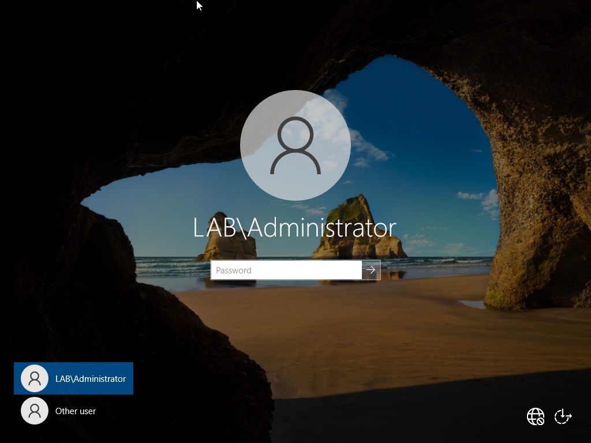

### 8. Select Active Directory Certificate Services (AD CS)
Back in Server Manager on `DC01.LAB.local`, selected **Active Directory Certificate Services**.

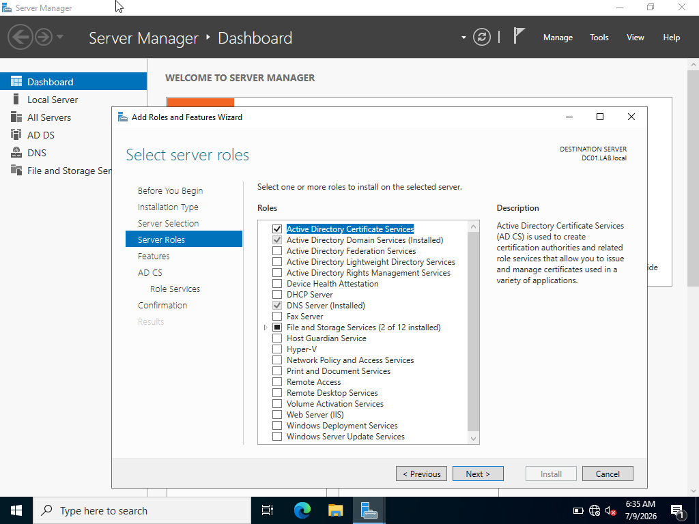

### 9. Install AD CS Role Services
Installed the Certification Authority role service and management tools.

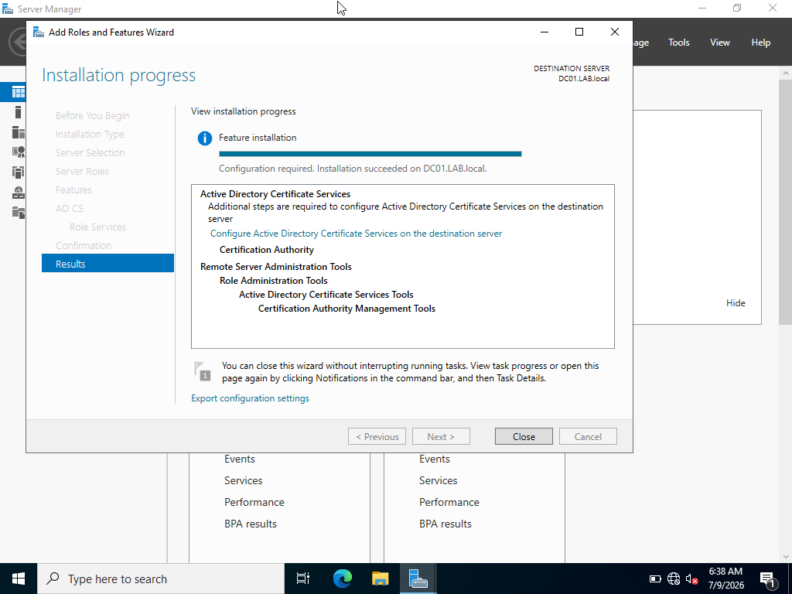

### 10. Configure Enterprise Root CA
Reviewed the AD CS Configuration summary for the Enterprise Root CA (`CN=LAB-DC01-CA,DC=LAB,DC=local`, SHA256, 2048-bit RSA key).

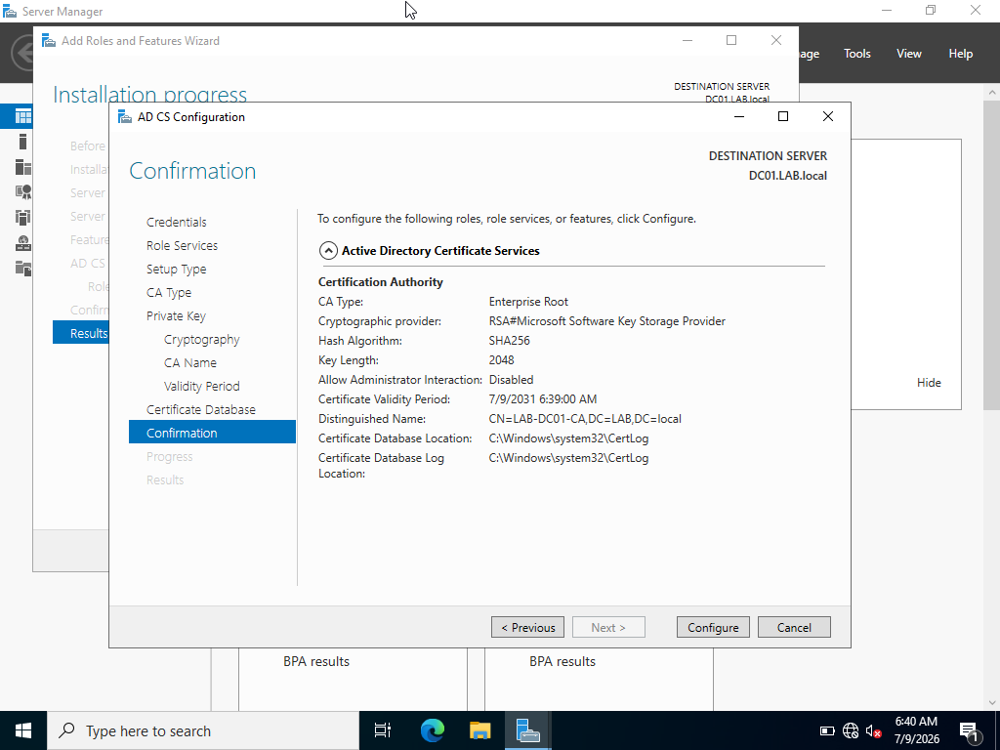

### 11. AD CS Configuration Succeeded
Confirmed Certification Authority configuration completed successfully.

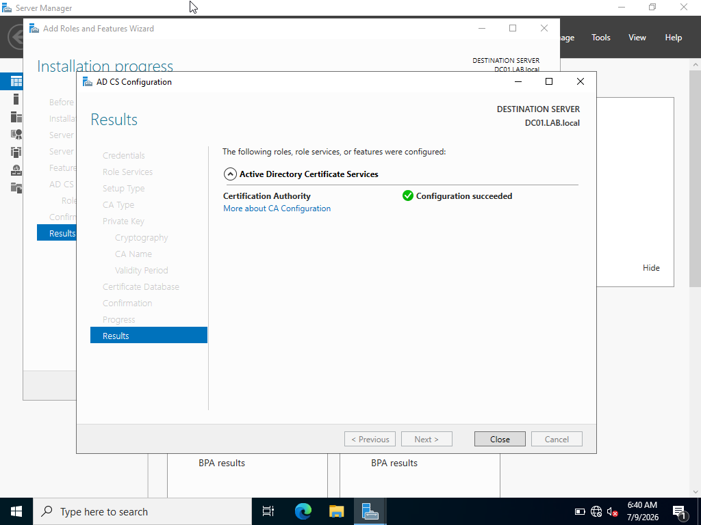

---

[← Back to Project Overview](../README.md) | [Day 2: Domain Users →](../day-02-domain-users/README.md)
