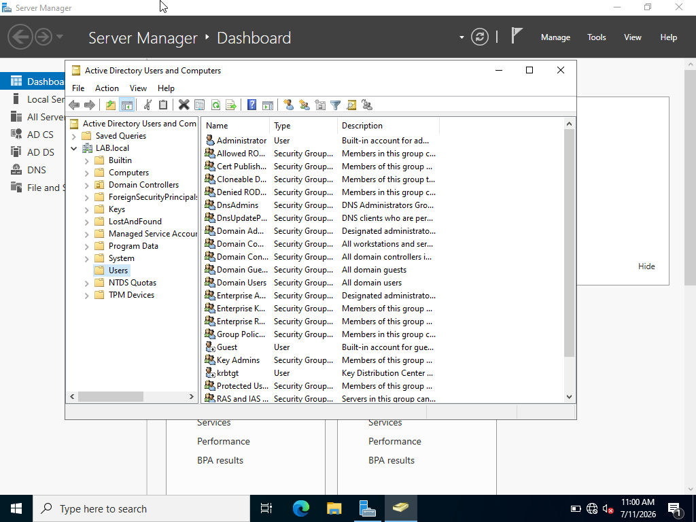
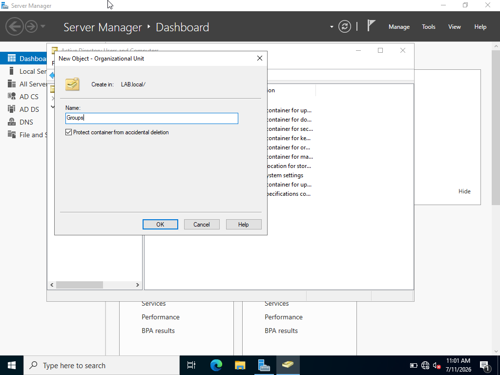
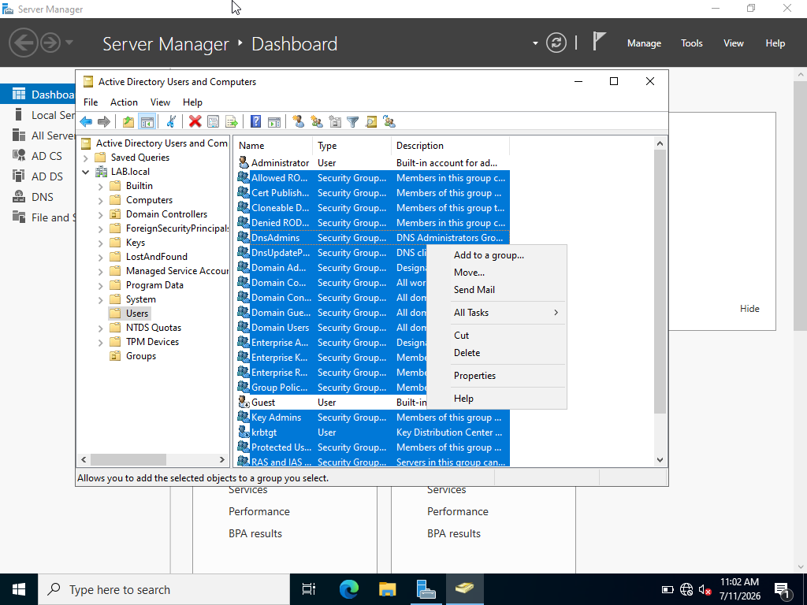
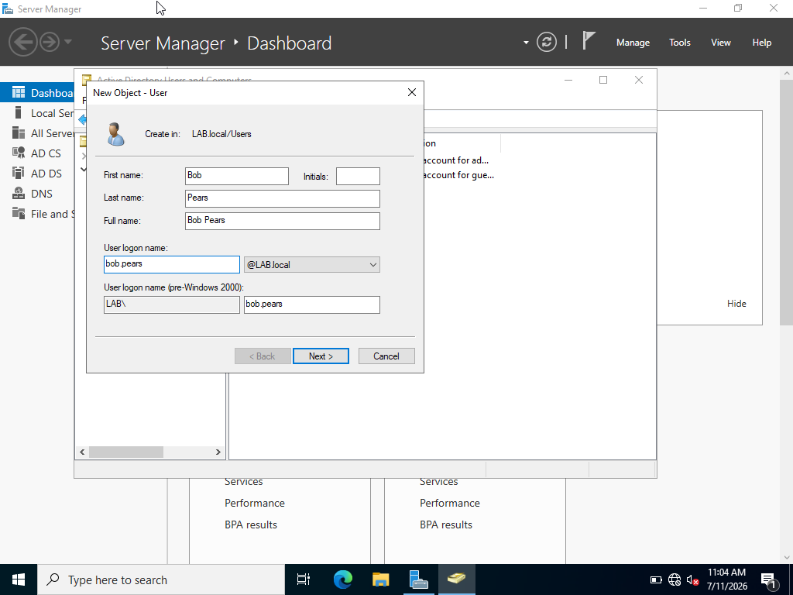

[← Day 1: Domain Controller](../day-01-domain-controller/README.md) | [Project Overview](../README.md) | [Day 3: Domain Join →](../day-03-domain-join/README.md)

# Day 2: Active Directory Users & Computers

Today I focused on Active Directory Users and Computers (ADUC):

- Created an Organizational Unit (OU) to organize built-in groups
- Reviewed the built-in `Administrator` account and confirmed it is the Domain Admin (should only be used when domain-level changes are needed — not for everyday tasks)
- Created my first domain user accounts with a consistent naming convention

> [!IMPORTANT]
> **Key Lesson:** In a real environment, you would never set **Password never expires** or skip forced password changes the way I did here for lab convenience — a good reminder of the gap between lab shortcuts and production security practices.

> **Next up:** Attaching a Windows 11 client to the domain and logging in as one of these users.

---

## Screenshots & Walkthrough

### 1. Open Active Directory Users and Computers
Opened ADUC on `DC01` and inspected the default `Users` container, including the built-in `Administrator` account and security groups.

### 2. Create an OU for Built-In Groups
Created a dedicated `Groups` Organizational Unit under `LAB.local` (with accidental deletion protection enabled).

### 3. Move Built-In Groups into the `Groups` OU
Selected built-in security groups in `Users` to organize them into the new `Groups` OU.

### 4. Create Domain User Accounts
Created domain user accounts (such as `Bob Pears`, `bob.pears@LAB.local`) following a consistent `firstname.lastname` naming convention.

### 5. Set Password Options
Set the initial password and checked **Password never expires** for lab convenience, noting why production environments enforce password rotation and change-at-next-logon policies.

---

[← Day 1: Domain Controller](../day-01-domain-controller/README.md) | [Project Overview](../README.md) | [Day 3: Domain Join →](../day-03-domain-join/README.md)
