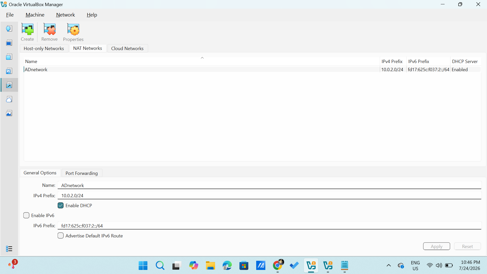
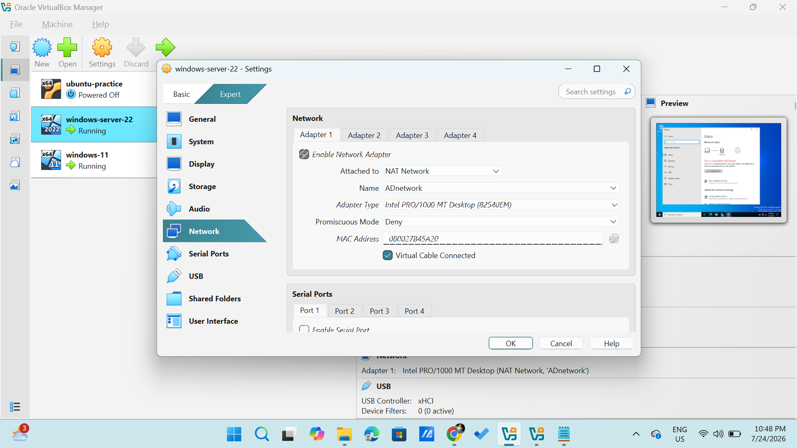
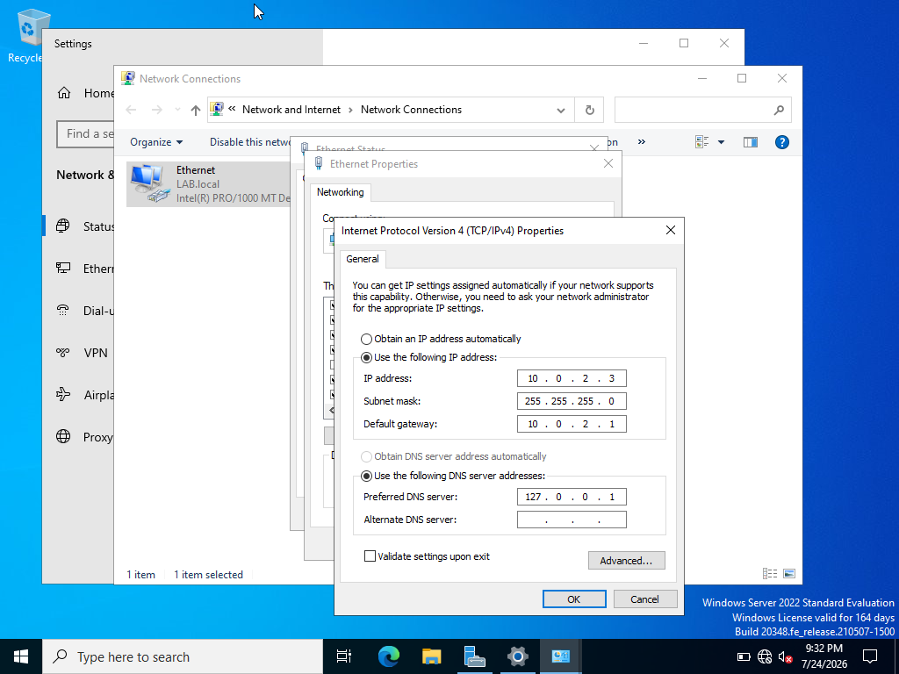
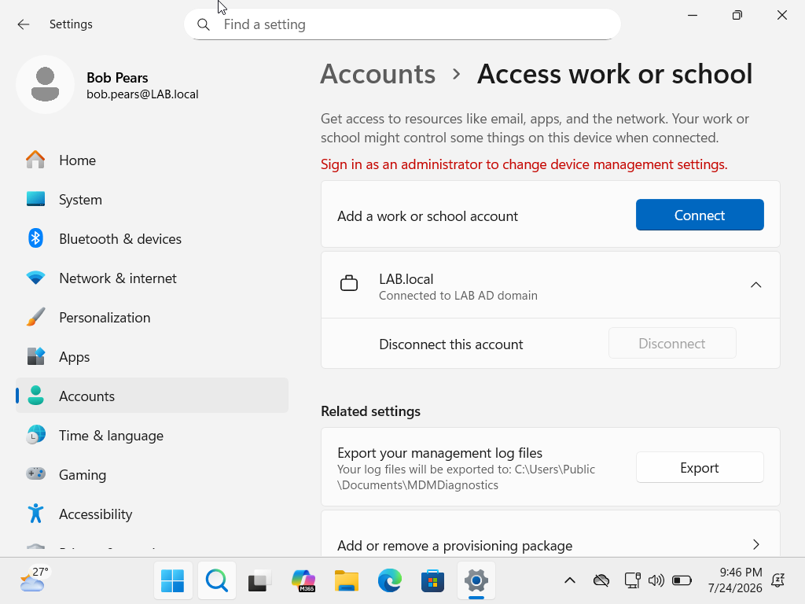

[← Day 2: Domain Users](../day-02-domain-users/README.md) | [Project Overview](../README.md) | [Day 4: OUs & File Shares →](../day-04-ous-and-file-shares/README.md)

# Day 3: Networking & Joining a Windows 11 Client to the Domain

Today I connected the two virtual machines together:

- Created a dedicated NAT network so my domain controller and client could communicate
- Set a static IP on the DC with DNS pointing to itself
- Joined my Windows 11 client (`WS01`) to the `LAB.local` domain
- Logged in using a domain user account created back on Day 2 — instead of the local admin account

> [!NOTE]
> **Small but important detail:** Logging in with the actual domain user (not the built-in `Administrator`) matters here — it is the same principle real IT support follows: use the least-privileged account needed for the task.

Verified the join from the domain controller side too — `WS01` now shows up under Active Directory's `Computers` container.

> **Next up:** Organizational Units, Group Policy, and PowerShell automation.

---

## Screenshots & Walkthrough

### 1. Create Dedicated VirtualBox NAT Network
Created a dedicated NAT Network named `ADnetwork` (`10.0.2.0/24`, DHCP enabled) in Oracle VirtualBox Manager so `DC01` and `WS01` share an isolated virtual subnet.

### 2. Attach VM Network Adapters to `ADnetwork`
Configured `windows-server-22` (`DC01`) Adapter 1 to use NAT Network `ADnetwork` (alongside the Windows 11 client).

### 3. Configure Static IP & Self-DNS on `DC01`
Assigned `DC01` a static IPv4 configuration (`10.0.2.3`, subnet mask `255.255.255.0`, gateway `10.0.2.1`) with Preferred DNS set to `127.0.0.1` so AD DNS resolves locally.

### 4. Join Windows 11 (`WS01`) & Sign In as Domain User
Joined `WS01` to `LAB.local` and signed in as `bob.pears@LAB.local`, confirming AD connectivity under **Accounts > Access work or school**.

---

[← Day 2: Domain Users](../day-02-domain-users/README.md) | [Project Overview](../README.md) | [Day 4: OUs & File Shares →](../day-04-ous-and-file-shares/README.md)
