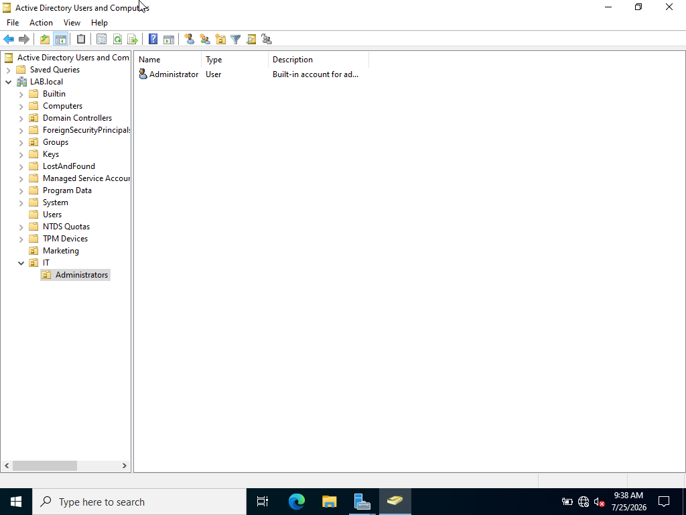
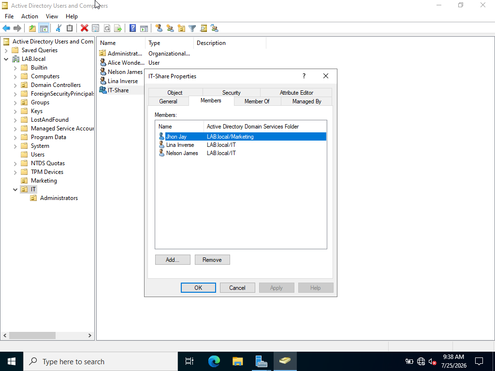
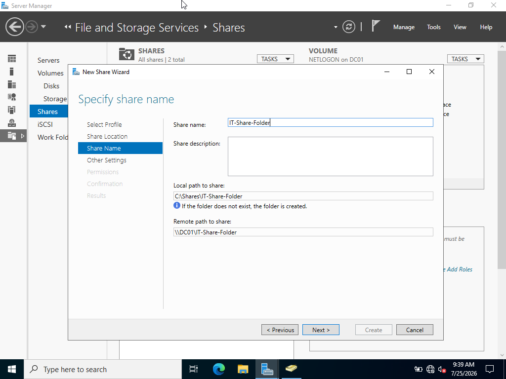
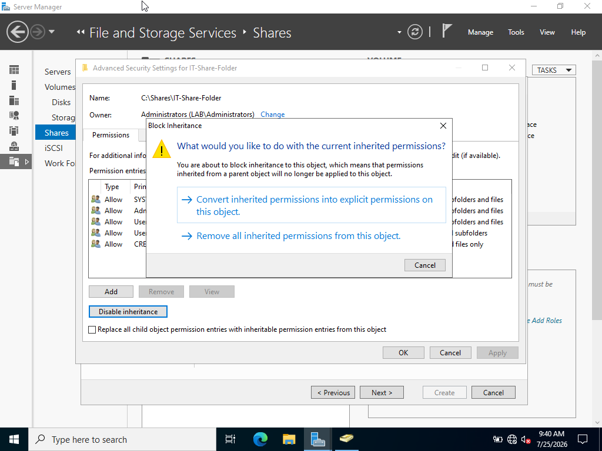
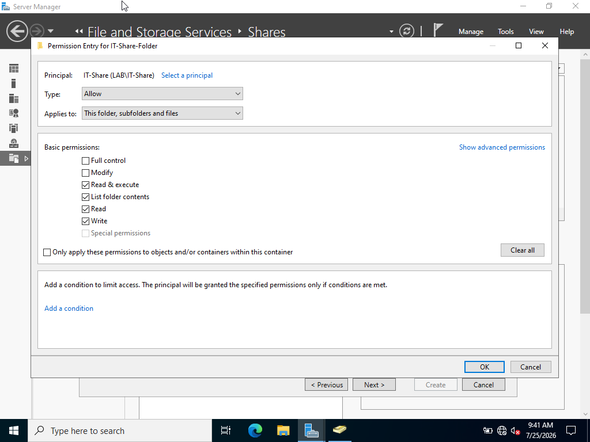
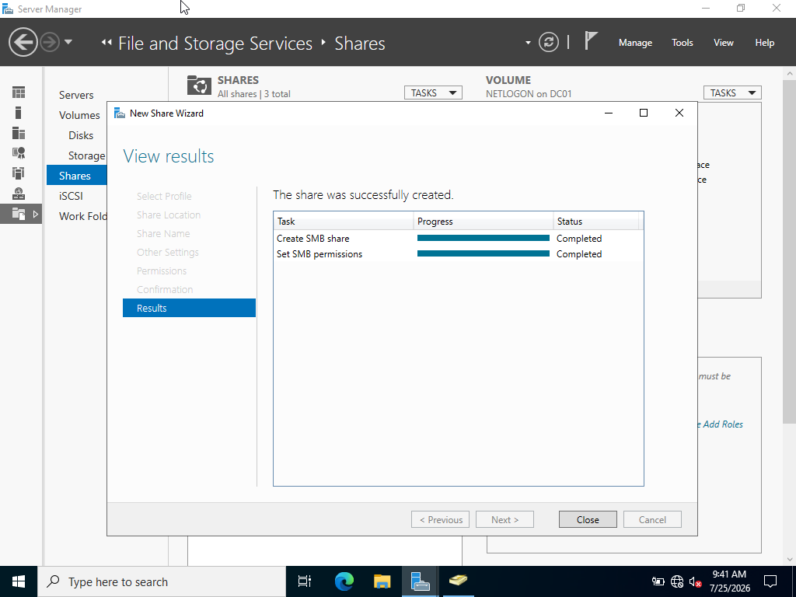
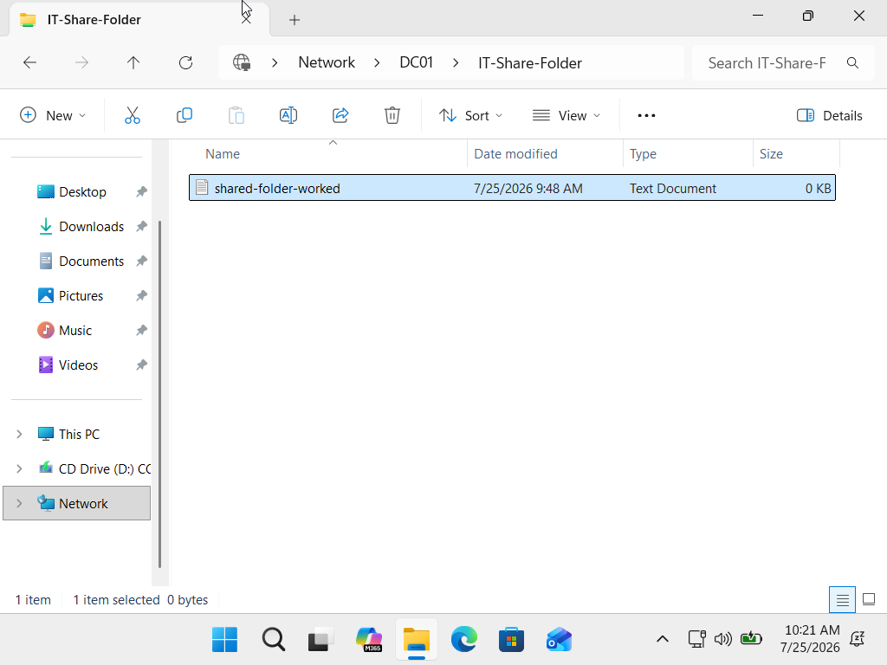
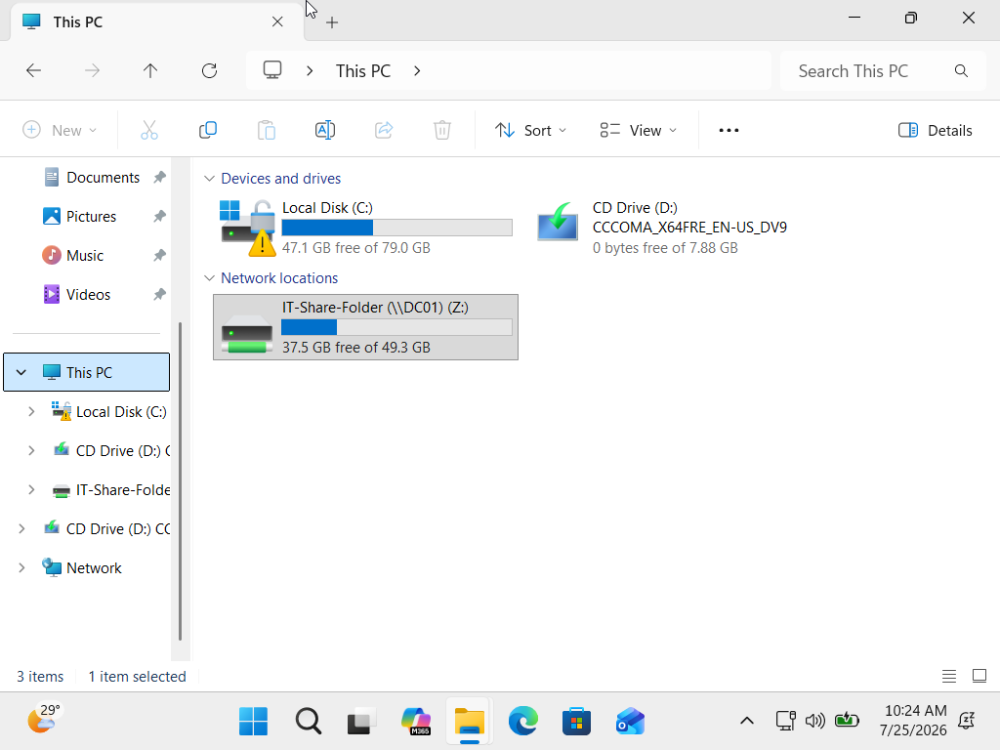
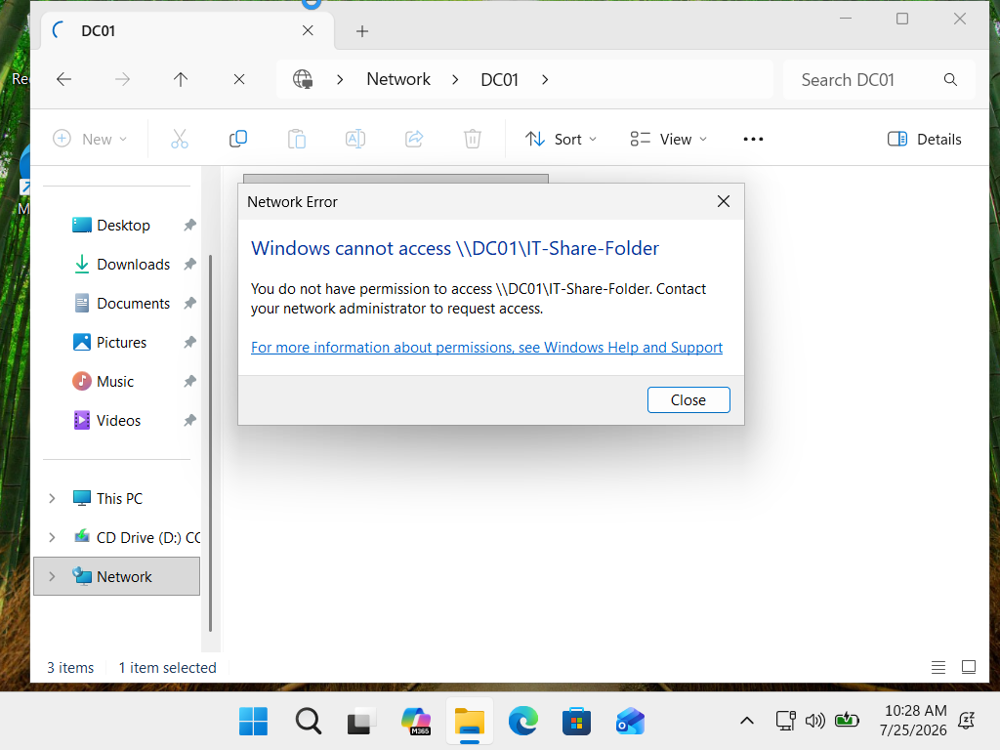

[← Day 3: Domain Join](../day-03-domain-join/README.md) | [Project Overview](../README.md) | [Day 5: GPO Account Lockout →](../day-05-gpo-lockout-policy/README.md)

# Day 4: Organizational Units, Security Groups & File Share Permissions

Today was about structure and access control:

- Created Organizational Units to mirror a real company's departments (`Marketing`, `IT`)
- Nested an `Administrators` OU inside `IT` to separate privileged accounts from regular staff
- Created a security group (`IT-Share`) and added specific users to it
- Set up a shared folder on the server (`\\DC01\IT-Share-Folder`), removed default access, and granted permissions only to that group
- Tested it two ways: logged in as a group member (worked ✅), then as a non-member (correctly denied ❌)

> [!TIP]
> This is a good example of the **principle of least privilege** in practice — access isn't given by default; it is explicitly granted to only the people who need it.

> **Next up:** Group Policy Objects.

---

## Screenshots & Walkthrough

### 1. Create Department Organizational Units
Created `Marketing` and `IT` OUs under `LAB.local`, organizing department users (`Alice Wonderland`, `Nelson James`, `Lina Inverse`) and the `IT-Share` security group inside `IT`.

### 2. Nest an `Administrators` OU Inside `IT`
Created a nested `Administrators` OU inside `IT` to separate privileged accounts (`Administrator`) from standard user accounts.

### 3. Add Specific Users to the `IT-Share` Security Group
Populated the `IT-Share` security group with authorized members (`Jhon Jay`, `Lina Inverse`, `Nelson James`).

### 4. Create the `IT-Share-Folder` SMB Share
Used Server Manager's New Share Wizard to create `IT-Share-Folder` at `C:\Shares\IT-Share-Folder` (`\\DC01\IT-Share-Folder`).

### 5. Disable Permission Inheritance
Opened Advanced Security Settings for `C:\Shares\IT-Share-Folder` and disabled inheritance to remove broad default user access.

### 6. Grant Explicit Permissions to `LAB\IT-Share`
Added an explicit Allow entry for `IT-Share (LAB\IT-Share)` with Read & execute, List folder contents, Read, and Write permissions.

### 7. Confirm Share Creation
Completed the New Share Wizard, creating the SMB share and applying the custom permissions.

### 8. Verify Access as a Group Member (Allowed ✅)
Logged in as an `IT-Share` member on the client, opened `\\DC01\IT-Share-Folder`, and created `shared-folder-worked.txt` to confirm read/write access.

### 9. Map the Shared Folder as Drive `Z:`
Mapped `\\DC01\IT-Share-Folder` as network drive `Z:` for convenient access in File Explorer.

### 10. Verify Access as a Non-Member (Denied ❌)
Logged in as a user outside the `IT-Share` group and attempted to open `\\DC01\IT-Share-Folder`, confirming Windows correctly denied access.

---

[← Day 3: Domain Join](../day-03-domain-join/README.md) | [Project Overview](../README.md) | [Day 5: GPO Account Lockout →](../day-05-gpo-lockout-policy/README.md)
