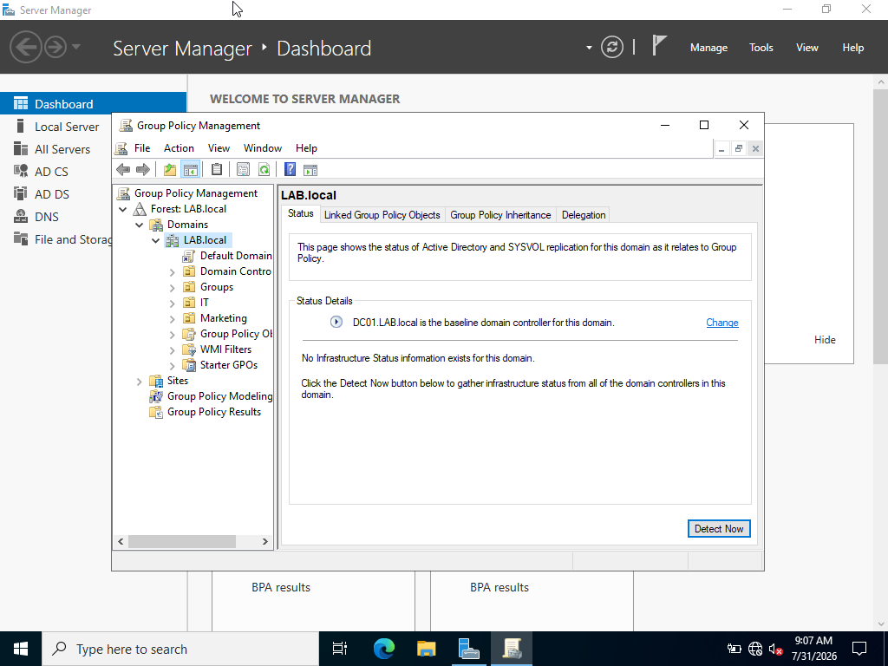
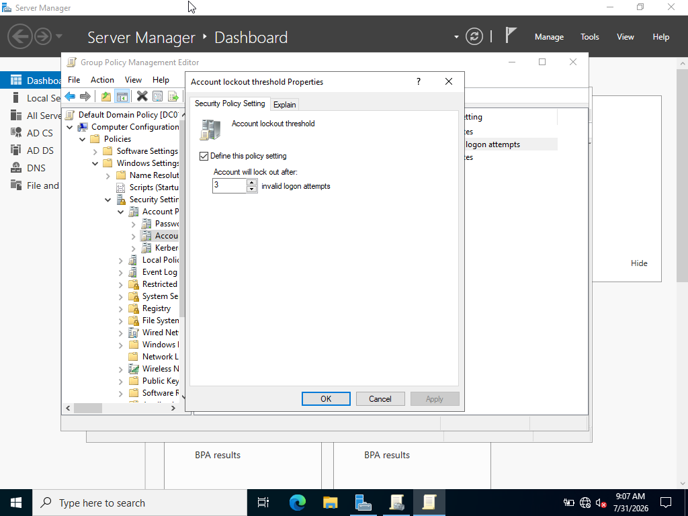
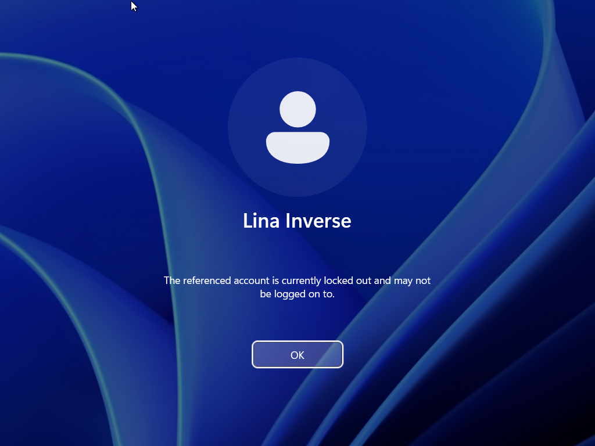

[← Day 4: OUs & File Shares](../day-04-ous-and-file-shares/README.md) | [Project Overview](../README.md) | [Day 6: PowerShell Automation →](../day-06-powershell-automation/README.md)

# Day 5: Group Policy Objects — The Troubleshooting Edition

Set out to configure an **Account Lockout Policy** via Group Policy: lock an account after 3 failed login attempts, then unlock it from the domain controller.

The policy didn't apply on the first try. Traced it through a few layers:

- **Domain-root scope requirement:** Account Lockout Policy only takes effect when linked at the domain root — not on individual OUs
- **GPO precedence conflict:** Even after moving it to the domain root, it still didn't fire, because `Default Domain Policy` had higher link order precedence and was silently overriding it with its default "never lock out" value
- **Elevation needed for diagnostics:** `gpresult` and `rsop.msc` both needed to be run elevated to actually show Computer Configuration data — without that, it looked like nothing was applying at all
- **Resolution:** Fixed it by configuring the lockout threshold directly inside `Default Domain Policy` instead of a separate competing GPO — removing the conflict entirely

Tested it end to end: locked an account after 3 wrong attempts, then unlocked it from Active Directory Users and Computers.

> [!NOTE]
> **Key Lesson:** This ended up being a much better lesson than the original plan — GPO precedence and inheritance are exactly the kind of thing that trips people up in real environments, and now I've actually debugged it firsthand.

---

## Screenshots & Walkthrough

### 1. Inspect Domain & OU Structure in GPMC
Opened Group Policy Management Console (`gpmc.msc`) to inspect `LAB.local`, `Default Domain Policy`, and the domain OUs (`Groups`, `IT`, `Marketing`).

### 2. Configure Account Lockout Threshold in `Default Domain Policy`
Edited `Default Domain Policy` under `Computer Configuration > Policies > Windows Settings > Security Settings > Account Policies > Account Lockout Policy` and set **Account lockout threshold** to `3` invalid logon attempts.

### 3. Verify Account Lockout on the Windows 11 Client
Tested 3 failed login attempts for `Lina Inverse` on `WS01` and confirmed the domain policy triggered: *"The referenced account is currently locked out and may not be logged on to."* before unlocking it from ADUC on `DC01`.

---

[← Day 4: OUs & File Shares](../day-04-ous-and-file-shares/README.md) | [Project Overview](../README.md) | [Day 6: PowerShell Automation →](../day-06-powershell-automation/README.md)
