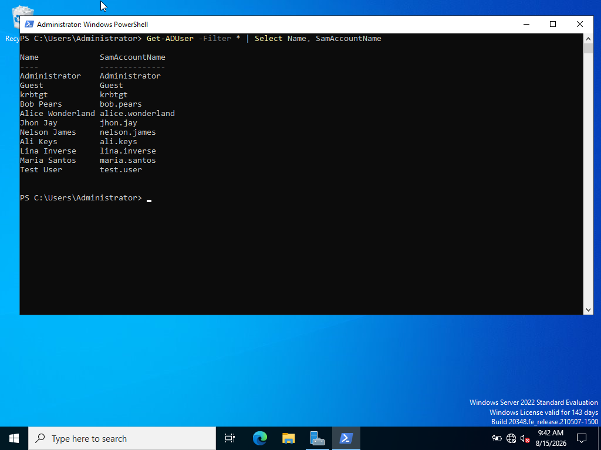
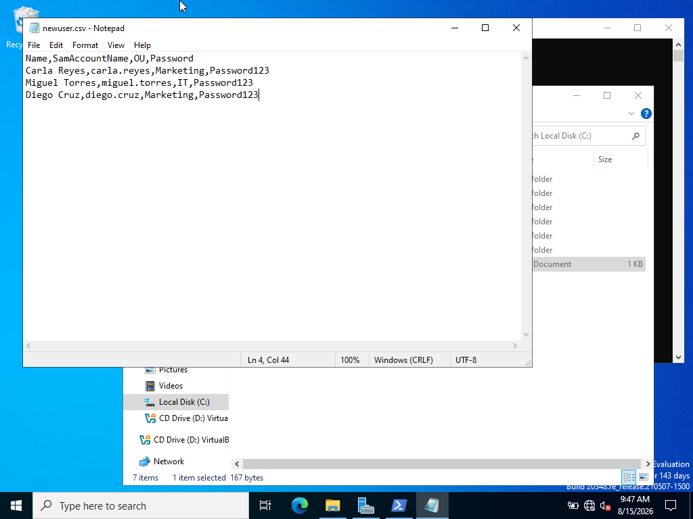
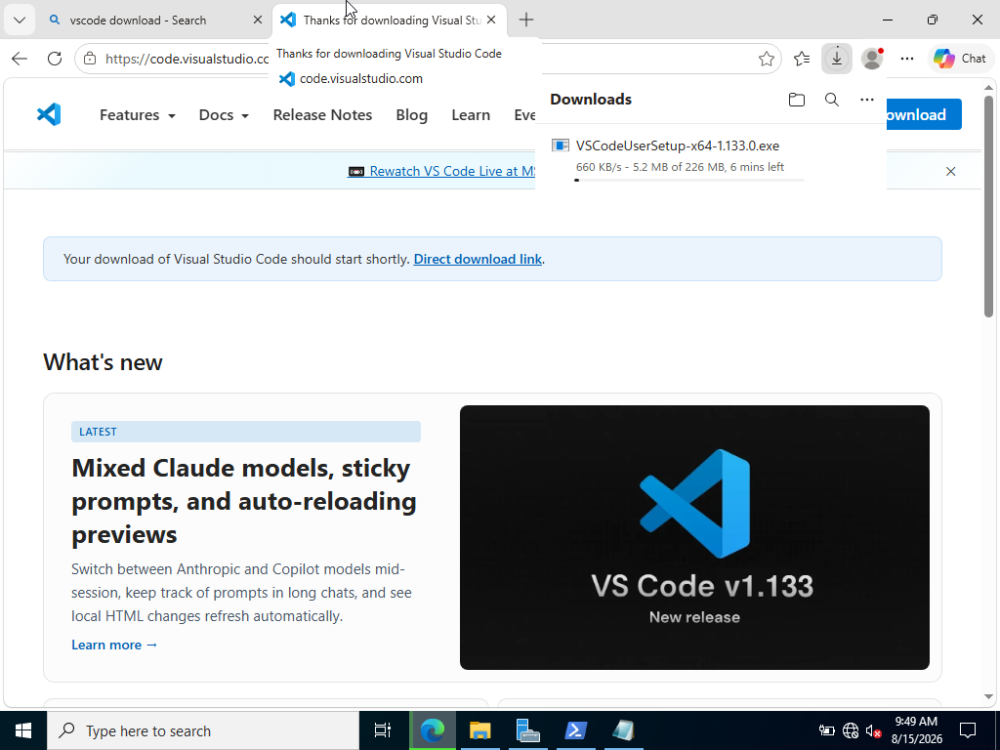
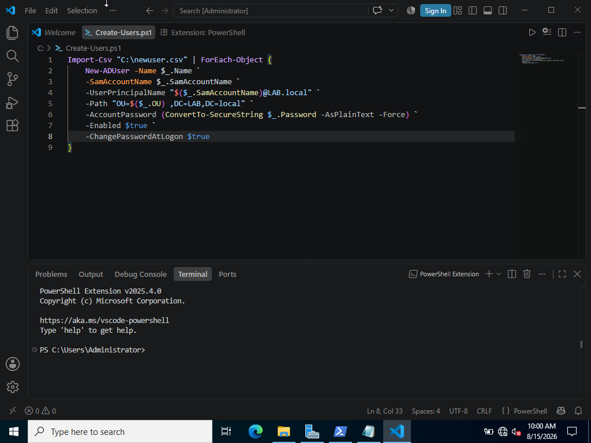
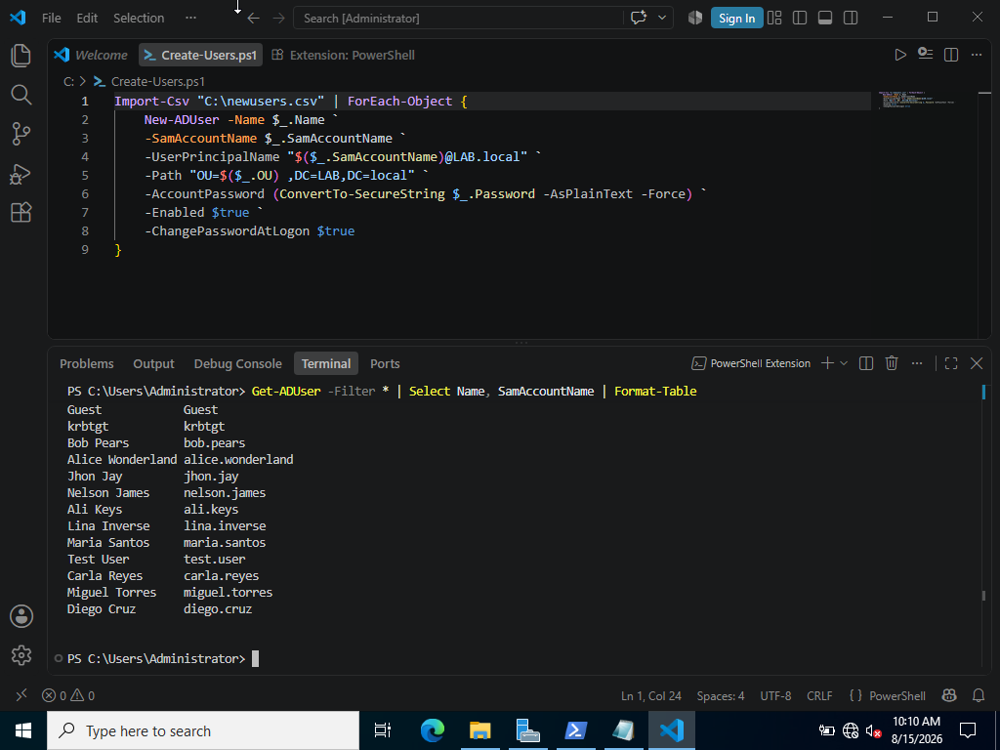

[← Day 5: GPO Account Lockout](../day-05-gpo-lockout-policy/README.md) | [Project Overview](../README.md)

# Day 6: Automating Active Directory Tasks with PowerShell

Moved from clicking through the GUI to managing Active Directory with PowerShell:

- Queried existing users and OUs directly from the command line
- Created a single user account with `New-ADUser`, understanding each parameter (`SamAccountName`, `UserPrincipalName`, `Path`, `SecureString` password)
- Built a CSV of multiple new hires and wrote a script to bulk-create all of them in one run, instead of clicking "New User" repeatedly

> [!TIP]
> This is the real difference between GUI work and scripting — creating 3 users by hand is fine, but creating 50 for a new office opening isn't something anyone does by clicking through a wizard fifty times. This is where IT starts to scale.

Used VS Code with the PowerShell extension to write and reuse the script, rather than typing one-off commands into a terminal.

---

## Screenshots & Walkthrough

### 1. Verify the `ActiveDirectory` PowerShell Module
Checked that the `ActiveDirectory` PowerShell module (`1.0.1.0`) was available in an elevated PowerShell session on `DC01`.

### 2. Query Existing Domain Users
Queried all existing accounts in `LAB.local` using `Get-ADUser -Filter * | Select Name, SamAccountName`.

### 3. Query Organizational Units
Listed all Organizational Units and their Distinguished Names using `Get-ADOrganizationalUnit -Filter * | Select Name, DistinguishedName`.

### 4. Inspect Single User Created with `New-ADUser`
Verified the attributes of the single test account (`test.user` in `OU=Marketing,DC=LAB,DC=local`) created from PowerShell.

### 5. Build the New-Hires CSV File
Prepared `newuser.csv` with `Name`, `SamAccountName`, `OU`, and `Password` columns for bulk user provisioning (`Carla Reyes`, `Miguel Torres`, `Diego Cruz`).

### 6. Set Up Visual Studio Code
Downloaded Visual Studio Code on `DC01` to edit and maintain reusable PowerShell scripts cleanly.

### 7. Author `Create-Users.ps1` with the PowerShell Extension
Wrote `Create-Users.ps1` in VS Code using `Import-Csv`, `ForEach-Object`, `New-ADUser`, and `ConvertTo-SecureString` (with `-ChangePasswordAtLogon $true`).

### 8. Verify Bulk-Created Accounts
Ran the bulk import script and confirmed `carla.reyes`, `miguel.torres`, and `diego.cruz` were created in Active Directory via `Get-ADUser`.

---

[← Day 5: GPO Account Lockout](../day-05-gpo-lockout-policy/README.md) | [Project Overview](../README.md)
